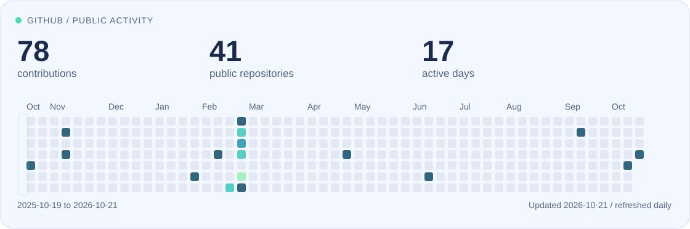

<picture>
  <source media="(max-width: 560px) and (prefers-color-scheme: dark)" srcset="assets/hero-mobile-dark.svg">
  <source media="(max-width: 560px)" srcset="assets/hero-mobile-light.svg">
  <source media="(prefers-color-scheme: dark)" srcset="assets/hero-dark.svg">
  
</picture>

  
  
  

## About me

I'm **Vishesh Sharma**, an **AI engineer and full-stack developer** in New York. I build Salesforce agents and web applications, from the interface to the services behind it.

At **[Peerstar](https://www.peerstarllc.com/)**, I build software for teams providing **peer support and recovery services**. My work helps staff manage referrals, coordinate care, follow up with people, and spend less time on repetitive tasks.

I also build **AI assistants** that help teams find information and take actions in their existing applications, with access controls and human review where needed.

Previously at **Accenture**. **MS in Computer Science, Pace University.**

## Technologies I work with

   &nbsp;
   &nbsp;
   &nbsp;
   &nbsp;
   &nbsp;
   &nbsp;
   &nbsp;
   &nbsp;
   &nbsp;
   &nbsp;
   &nbsp;
   &nbsp;

**AI &amp; Salesforce** · Agentforce, LLM integrations, tool calling, Apex, Lightning Web Components, SOQL 
**Applications &amp; delivery** · React, TypeScript, Java, Spring Boot, Python, cloud services, Docker, CI/CD

## Selected projects

<a href="https://github.com/vishesh381/OrgForge">
<picture>
  <source media="(max-width: 560px) and (prefers-color-scheme: dark)" srcset="assets/project-orgforge-mobile-dark.svg">
  <source media="(max-width: 560px)" srcset="assets/project-orgforge-mobile-light.svg">
  <source media="(prefers-color-scheme: dark)" srcset="assets/project-orgforge-dark.svg">
  
</picture>
</a>

<a href="https://github.com/vishesh381/ApexPulse">
<picture>
  <source media="(max-width: 560px) and (prefers-color-scheme: dark)" srcset="assets/project-apexpulse-mobile-dark.svg">
  <source media="(max-width: 560px)" srcset="assets/project-apexpulse-mobile-light.svg">
  <source media="(prefers-color-scheme: dark)" srcset="assets/project-apexpulse-dark.svg">
  
</picture>
</a>

<a href="https://github.com/vishesh381/SwiftInvoice">
<picture>
  <source media="(max-width: 560px) and (prefers-color-scheme: dark)" srcset="assets/project-swiftinvoice-mobile-dark.svg">
  <source media="(max-width: 560px)" srcset="assets/project-swiftinvoice-mobile-light.svg">
  <source media="(prefers-color-scheme: dark)" srcset="assets/project-swiftinvoice-dark.svg">
  
</picture>
</a>

<a href="https://github.com/vishesh381/Skillbridge_Frontend">
<picture>
  <source media="(max-width: 560px) and (prefers-color-scheme: dark)" srcset="assets/project-skillbridge-mobile-dark.svg">
  <source media="(max-width: 560px)" srcset="assets/project-skillbridge-mobile-light.svg">
  <source media="(prefers-color-scheme: dark)" srcset="assets/project-skillbridge-dark.svg">
  
</picture>
</a>

Also built **[Gatherly](https://github.com/vishesh381/Gatherly---Your-Invitation-App)** for Salesforce invitations and RSVPs, and explored machine learning in **[California Housing](https://github.com/vishesh381/California-Housing-Prices)**.

## Contribution activity

<picture>
  <source media="(max-width: 560px) and (prefers-color-scheme: dark)" srcset="assets/activity-mobile-dark.svg">
  <source media="(max-width: 560px)" srcset="assets/activity-mobile-light.svg">
  <source media="(prefers-color-scheme: dark)" srcset="assets/activity-dark.svg">
  
</picture>

How this section updates

The calendar and counts refresh daily from my public GitHub profile. They show contributions visible to visitors, with the date range and update date on the card. Private repository contents are never included.

[View my contribution history](https://github.com/vishesh381?tab=overview#year-list-container)

## Let's connect

Interested in **AI agents, Salesforce, healthcare software, or full-stack development**? I'd be glad to connect.

  
  

