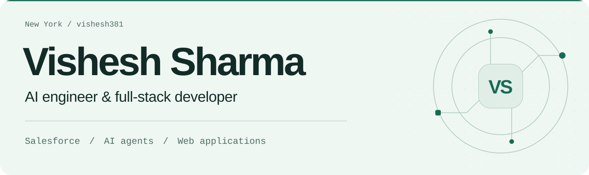

<picture>
  <source media="(max-width: 560px) and (prefers-color-scheme: dark)" srcset="assets/header-mobile-dark.svg">
  <source media="(max-width: 560px)" srcset="assets/header-mobile-light.svg">
  <source media="(prefers-color-scheme: dark)" srcset="assets/header-dark.svg">
  
</picture>

  <a href="#about">About</a> &nbsp;·&nbsp;
  <a href="#at-peerstar">Peerstar</a> &nbsp;·&nbsp;
  <a href="#selected-projects">Projects</a> &nbsp;·&nbsp;
  <a href="https://www.linkedin.com/in/vishesh-sharma-0444b8169/">LinkedIn</a> &nbsp;·&nbsp;
  <a href="https://drive.google.com/file/d/1y_5YvrfMyeerwPUX-2dI1lqBjGhXhxHf/view">Resume</a>

## About

I'm **Vishesh Sharma**, an **AI engineer and full-stack developer** based in New York. I build AI agents, Salesforce applications, and web products, from the interface people use to the services behind it.

My work combines **AI engineering, product development, and healthcare technology**. I build the software, connect the systems, and work through the details that make a product useful in daily work.

## At Peerstar

At [Peerstar](https://www.peerstarllc.com/), I build software for teams providing **peer support and recovery services**. The work supports the people helping others access support, stay connected, and work toward their recovery goals.

I'm helping teams manage referrals, coordinate appointments, keep track of follow-ups, and find the information they need. I also build AI assistants that help staff find answers and complete routine work, with people reviewing the actions that need their judgment.

## AI engineering

I build agents that can work with business information and use tools inside existing applications. My focus includes **Salesforce Agentforce, LLM integrations, tool calling, and conversational interfaces**, along with the access checks, validation, and testing those systems need.

[OrgForge](https://github.com/vishesh381/OrgForge) is a public example: it includes an AI-assisted chat interface for generating Salesforce queries alongside tools for understanding and managing an org.

## Selected projects

<table>
  <tr>
    <td width="50%" valign="top">
      <h3><a href="https://github.com/vishesh381/OrgForge">OrgForge</a></h3>
      
A Salesforce workspace for org health, permissions, deployments, and AI-assisted query generation.

      
<code>React</code> <code>Java</code> <code>Spring Boot</code> <code>AI</code>

    </td>
    <td width="50%" valign="top">
      <h3><a href="https://github.com/vishesh381/ApexPulse">ApexPulse</a></h3>
      
Apex test execution with live progress, code coverage, and historical results.

      
<code>React</code> <code>Spring Boot</code> <code>Salesforce</code>

    </td>
  </tr>
  <tr>
    <td width="50%" valign="top">
      <h3><a href="https://github.com/vishesh381/SwiftInvoice">SwiftInvoice</a></h3>
      
Invoicing and billing with online payments, PDF invoices, and reporting.

      
<code>React</code> <code>Spring Boot</code> <code>AWS</code>

    </td>
    <td width="50%" valign="top">
      <h3><a href="https://github.com/vishesh381/Skillbridge_Frontend">SkillBridge</a></h3>
      
A full-stack job application portal with separate frontend and backend services.

      
<code>React</code> <code>TypeScript</code> <code>Java</code>

      
<a href="https://github.com/vishesh381/Skillbridge_Backend">Backend source</a>

    </td>
  </tr>
  <tr>
    <td width="50%" valign="top">
      <h3><a href="https://github.com/vishesh381/Gatherly---Your-Invitation-App">Gatherly</a></h3>
      
A Salesforce application for event invitations and RSVP management.

      
<code>Salesforce</code> <code>Lightning Web Components</code>

    </td>
    <td width="50%" valign="top">
      <h3><a href="https://github.com/vishesh381/California-Housing-Prices">California housing</a></h3>
      
Machine learning experiments for estimating house prices from housing data.

      
<code>Python</code> <code>Machine learning</code>

    </td>
  </tr>
</table>

[Explore my public repositories →](https://github.com/vishesh381?tab=repositories)

## Toolkit

**AI & agents** · Agentforce, LLM integrations, tool calling, prompt design 
**Salesforce** · Apex, Lightning Web Components, SOQL, REST APIs 
**Web & services** · React, TypeScript, Java, Spring Boot, Python 
**Cloud & delivery** · Azure, AWS, Docker, GitHub Actions

## Connect

I'm interested in AI agents, healthcare software, Salesforce products, and full-stack engineering.

[Connect on LinkedIn](https://www.linkedin.com/in/vishesh-sharma-0444b8169/) · [View my resume](https://drive.google.com/file/d/1y_5YvrfMyeerwPUX-2dI1lqBjGhXhxHf/view)
